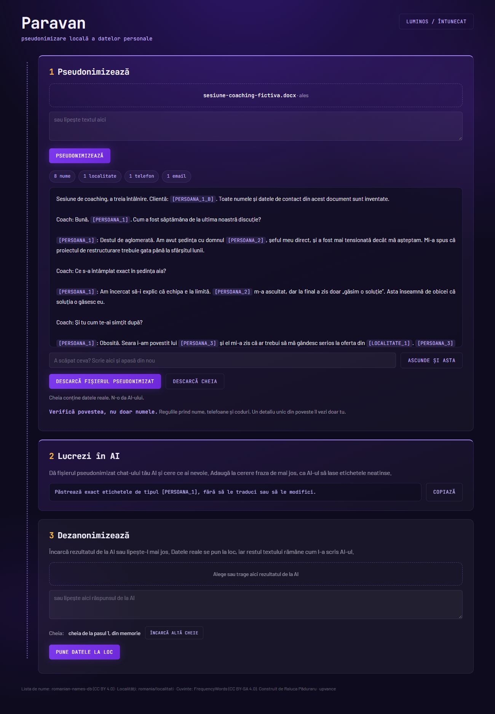

# Paravan

**Pseudonimizare locală a datelor personale.** Paravan ascunde datele personale dintr-un fișier înainte să-l dai unui AI din cloud, apoi le pune la loc în rezultat. Totul se întâmplă în browserul de pe laptopul tău. Fișierul nu pleacă nicăieri.



## Cum îl folosești, în 3 pași

1. **Pseudonimizezi.** Încarci un fișier `.md`, `.txt`, `.docx`, `.pdf`, `.csv` sau `.xlsx` (sau lipești un text) și apeși „Pseudonimizează”. Numele, telefoanele, emailurile și celelalte date devin etichete: „Maria Popescu” devine `[PERSOANA_1]`, iar „0722 123 456” devine `[TELEFON_1]`. Descarci fișierul pseudonimizat și cheia.
2. **Lucrezi în AI.** Dai fișierul pseudonimizat chat-ului tău AI și ceri ce ai nevoie: un rezumat, o notă de sesiune, un plan de acțiune. Adaugi fraza din aplicație, ca AI-ul să lase etichetele neschimbate.
3. **Dezanonimizezi.** Încarci în Paravan răspunsul de la AI. Aplicația pune datele reale la loc, iar restul textului rămâne cum l-a scris AI-ul.

## Cum îl deschizi

Descarci fișierul `paravan.html` și îl deschizi cu dublu-click. Merge în Chrome, Edge, Safari și Firefox, pe Windows și pe Mac. Nu instalezi nimic și nu ai nevoie de internet: poți opri wi-fi-ul după ce l-ai deschis. Pagina are o regulă de securitate care îi interzice browserului orice conexiune la internet.

## De ce „pseudonimizare” și nu „anonimizare”

Datele se pot pune la loc cu cheia. De aceea, după GDPR (art. 4 pct. 5), vorbim de pseudonimizare: datele rămân date personale cât timp există cheia. **Cheia conține datele reale. N-o da AI-ului și păstreaz-o ca pe documentul original.**

## Ce prinde și ce nu prinde

Paravan lucrează cu reguli fixe și liste, fără model AI. Prinde:

- nume și prenume (liste de nume românești, diminutive, forme ca „Mariei” sau „lui Popescu”, „dl.”, „doamna”), plus orice cuvânt scris cu literă mare care nu e un cuvânt obișnuit din română, ca să prindă și numele străine sau rare;
- CNP, telefon, email, IBAN, număr de card, serie și număr de buletin sau pașaport, data nașterii, adresă, localitate, număr de înmatriculare, adresă IP, firmă (SRL, SA, PFA).

Regula de siguranță ascunde uneori și cuvinte inofensive, de exemplu un cuvânt rar de la începutul unei propoziții. Am ales asta intenționat: o etichetă în plus strică puțin textul, un nume scăpat strică încrederea. Dacă vezi ceva scăpat, îl scrii în câmpul „A scăpat ceva?” și apeși din nou.

**Ce nu prinde: detaliile unice din poveste.** „Singura femeie din echipa de conducere”, un diagnostic sau un eveniment anume pot identifica o persoană fără niciun nume. Verifică povestea, nu doar numele.

## Formate

| Încarci | La pasul 1 primești | La pasul 3 primești |
|---|---|---|
| `.md`, `.txt` | același format | același format |
| `.csv`, `.xlsx` | același format, celulă cu celulă; `.xlsx` iese ca registru nou, doar cu valori (fără comentarii, linkuri, formule și metadate) | același format |
| `.docx` | `.md` | `.docx`, dacă etichetele se pot înlocui fără să strice documentul; altfel `.md` |
| `.pdf` (cu text) | `.md` | `.md` |

Un PDF scanat, fără text, primește un mesaj clar. În tabele, o coloană cu antet de date personale („Nume”, „Telefon”, „Data nașterii”) se ascunde întreagă. Numele fișierului trece și el prin reguli, ca fișierul dat AI-ului să nu poarte numele clientului.

## Exemplu

În `exemple/` găsești o sesiune de coaching inventată, în `.md` și `.docx`, pe care poți încerca aplicația. Toate numele și datele de contact din ea sunt inventate.

## Pentru cine vrea să modifice codul

```
npm install
npm test          # testele de reguli, formate și cazuri grele
npm run e2e       # construiește dist/paravan.html și îl testează în Chrome
npm run build     # doar construiește dist/paravan.html
```

Listele de nume, localități și cuvinte se refac cu `npm run fetch-data`.

## Licențe

Codul are licența MIT (vezi `LICENSE`). Lista de nume vine din [romanian-names-db](https://github.com/andyhatestheworld/romanian-names-db) (CC BY 4.0), localitățile din [romania/localitati](https://github.com/romania/localitati) (WTFPL), iar lista de cuvinte din [FrequencyWords](https://github.com/hermitdave/FrequencyWords) (CC BY-SA 4.0). Detalii în `DATA-LICENSES.md`.

Construit de Raluca Păduraru, cu Claude Code.
